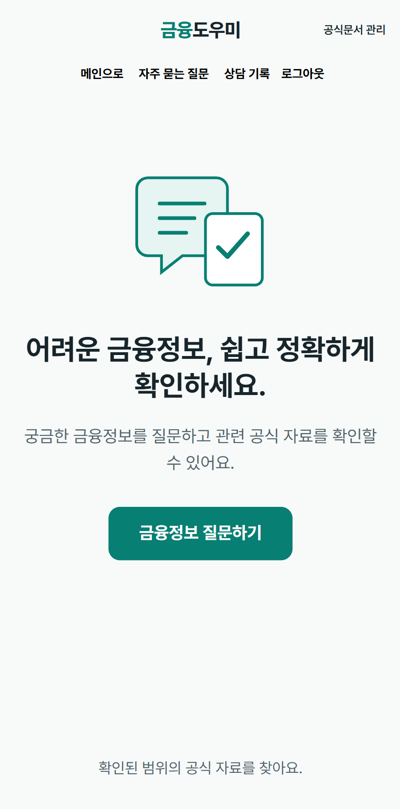
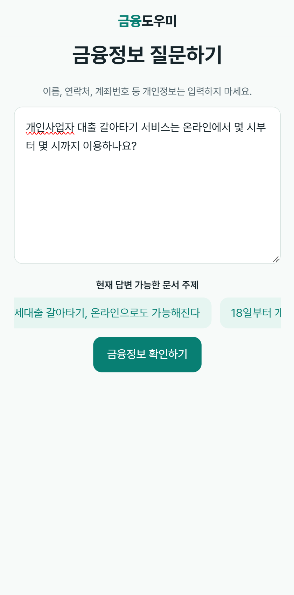
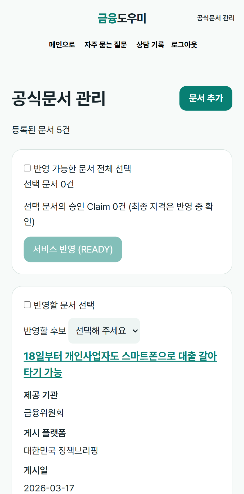
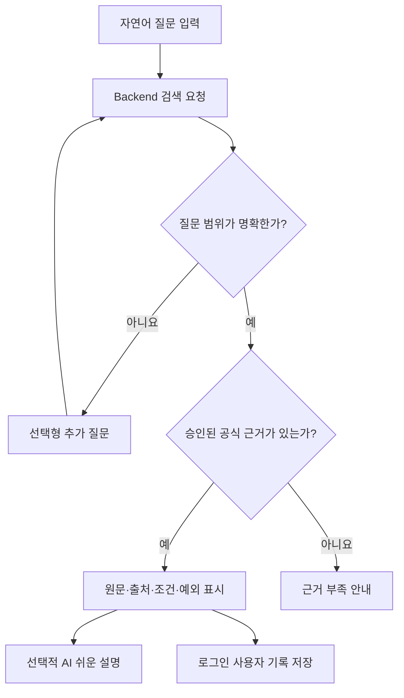

# 금융도우미 Frontend

금융도우미는 사용자의 자연어 금융 질문을 공식문서의 검토된 근거와 연결하여, 출처와 적용 조건·예외를 함께 제공하는 금융정보 안내 웹 서비스입니다.

이 저장소는 사용자 화면과 공식문서 검토자(Reviewer) 화면을 담당합니다.

## 1. 프로젝트 소개

초기에는 금융 피해 유형별 상담과 대응 절차를 제공하는 서비스를 구상했습니다.

그러나 실제 금융정보 질문은 하나의 카테고리로 구분하기 어렵고, 같은 질문도 상품과 신청 목적에 따라 답변이 달라질 수 있었습니다.

이에 고정된 카테고리보다 자연어 질문을 중심으로 정보를 탐색하고, 필요한 경우 추가 질문으로 범위를 구체화하는 구조를 선택했습니다.

서비스는 금융상품의 가입 자격이나 법적 효력을 최종 판정하는 대신, 사람이 검토한 공식 근거를 안내합니다.

## 2. 주요 기능

| 기능 | 설명 |
| --- | --- |
| 자연어 금융정보 질문 | 사용자가 궁금한 금융정보를 자유롭게 입력 |
| 질문 구체화 | 상품·대상·목적이 모호하면 선택형 질문으로 범위 확인 |
| 공식 근거 조회 | 승인된 원문 발췌와 출처, 적용 조건 및 예외 표시 |
| FAQ | Reviewer가 게시한 질문과 승인 근거 제공 |
| 상담 기록 | 로그인 사용자의 검색 결과 저장·조회·삭제 |
| 선택적 AI 설명 | 공식 근거의 쉬운 설명 요청과 검증 실패 시 대체 처리 |
| Reviewer 화면 | 공식문서 등록, Claim 검토·승인, READY 및 FAQ 관리 |

## 3. 서비스 화면

### 메인 화면과 자연어 질문

| 메인 화면 | 질문 입력 | 질문 구체화 |
| :---: | :---: | :---: |
|  |  |  |

사용자는 자연어로 질문하고, 대상이나 목적을 특정할 필요가 있을 때만 추가 선택지를 확인합니다.

### FAQ


FAQ는 별도의 AI 답변을 생성하는 대신, Reviewer가 공개 대상으로 지정한 질문과 공식 근거를 연결합니다.

### 공식문서 검토자 화면

| 문서 목록 | Claim 검토 | 공식문서 등록 |
| :---: | :---: | :---: |
|  |  |  |

## 4. 사용자 요청 흐름



### 질문 구체화 설계

고정 카테고리만으로는 다양한 자연어 질문의 의도를 표현하기 어려웠습니다.

따라서 질문이 명확한 경우에는 바로 검색을 진행하고, 대상 금융상품이나 질문 목적이 모호한 경우에만 추가 질문을 제공합니다.

사용자가 선택을 변경하면 이전 선택에 종속된 상태를 초기화하고, 늦게 도착한 이전 요청의 응답이 현재 화면을 덮어쓰지 않도록 처리했습니다.

## 5. 기술 스택

| 영역 | 기술 |
| --- | --- |
| Framework | Next.js 16.3.2 |
| UI | React 19.2.8 |
| Language | TypeScript |
| Styling | Tailwind CSS 4 |
| 서버 상태 | TanStack Query 5 |
| 질문 흐름 상태 | Zustand 5 |
| API | Fetch API, Spring Boot REST API |

### 상태 관리 원칙

- **TanStack Query:** 세션 등 서버 데이터의 조회와 캐싱
- **Zustand:** 질문 입력과 다단계 구체화 상태
- **React Local State:** 화면 단위 입력과 요청 상태
- **Backend:** 인증, 승인 상태, 검색 자격 및 저장된 기록의 기준

사용자 질문과 민감한 상담 정보를 브라우저 Local Storage에 영구 저장하지 않습니다.

## 6. 테스트 및 검증

다음 항목을 중심으로 단위·화면 계약 및 합성 API 기반 브라우저 검증을 진행했습니다.

- 자연어 질문과 추가 질문 상태 변경
- 이전 비동기 응답의 무효화
- 공식 근거·조건·예외 표시
- FAQ 및 상담 기록 화면
- Reviewer 관련 화면 계약
- TypeScript, ESLint, 프로덕션 빌드

실행 명령:

```bash
npm test
npx tsc --noEmit
npm run lint
npm run build
```

## 7. 로컬 실행

### 설치

```bash
npm ci
```

`.env.example`을 참고하여 `.env.local`을 생성합니다.

```env
NEXT_PUBLIC_API_BASE_URL=http://localhost:8080/api/v1
```

### 개발 서버

```bash
npm run dev
```

기본 접속 주소:

```text
http://localhost:3000
```

### 프로덕션 실행

```bash
npm run build
npm run start
```

Backend와 연결하려면 실제 실행 포트 및 CORS 설정을 맞춰야 합니다.

API 키, 데이터베이스 비밀번호, OAuth Client Secret 등 비밀정보는 `NEXT_PUBLIC_*` 환경변수에 저장하지 않습니다.

## 관련 링크

- [Backend Repository](https://github.com/Economy0326/financial-helper-backend)
- [금융도우미 프로젝트 문서 (Notion)](https://app.notion.com/p/3bd25931ce3580ae8ad8f0fa3acdf41a)