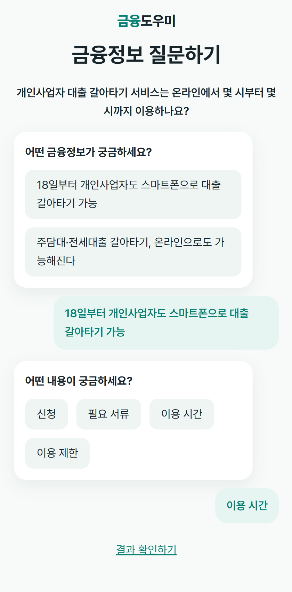
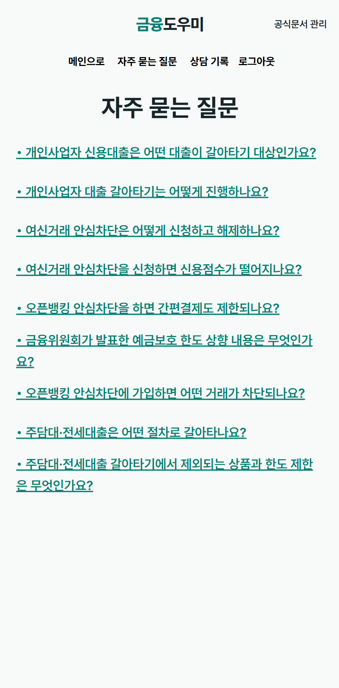
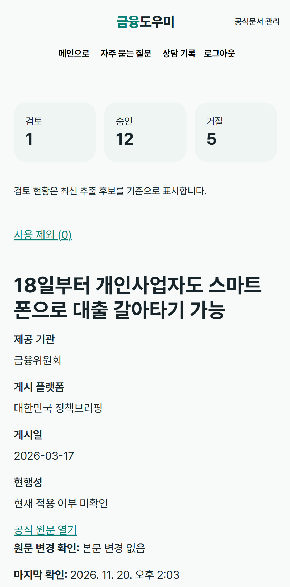
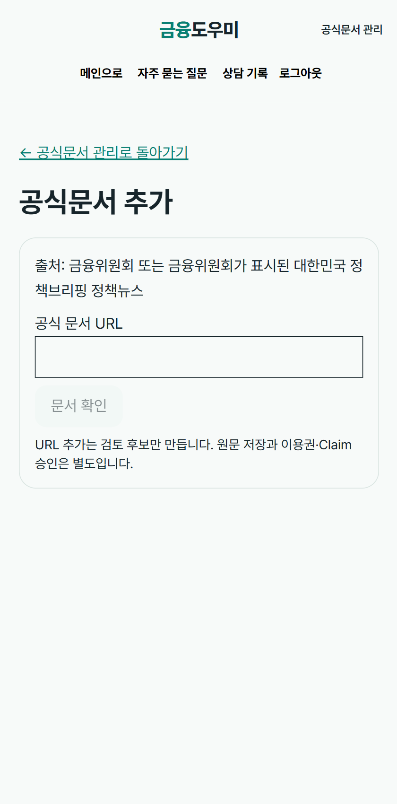
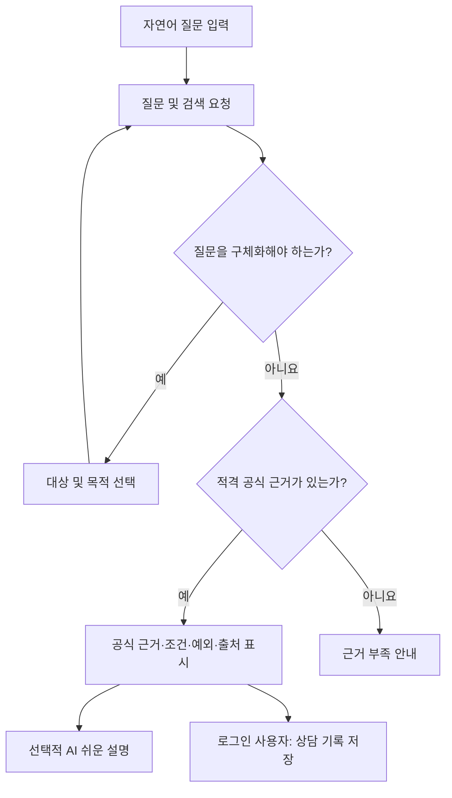

# 금융도우미 Frontend

공식 금융문서에서 검토·승인한 근거를 자연어 질문으로 찾고, 적용 조건과 예외, 출처를 함께 확인할 수 있도록 개발한 금융정보 안내 웹 서비스입니다.

금융정보를 단순히 AI가 생성하는 대신, 사람이 검토한 공식 근거를 중심으로 안내하며 질문이 모호하거나 충분한 근거가 없으면 확정적인 답변을 제한합니다.

이 저장소는 사용자 화면과 공식문서 검토자(Reviewer) 화면을 담당합니다.

## 1. 주요 기능

| 기능 | 설명 |
| --- | --- |
| 자연어 질문 | 사용자가 궁금한 금융정보를 자유롭게 입력 |
| 질문 구체화 | 질문의 대상이나 목적이 모호할 때 선택지를 통해 범위 확인 |
| 공식 근거 확인 | 검토된 원문 발췌, 출처, 게시일, 적용 조건과 예외 표시 |
| 자주 묻는 질문 | Reviewer가 게시한 FAQ와 연결된 공식 근거 확인 |
| 상담 기록 | 로그인 사용자의 검색 결과 저장·조회·삭제 |
| 선택적 AI 설명 | 승인된 근거에 대한 쉬운 설명 요청 및 실패 시 안전한 대체 처리 |
| Reviewer | 공식문서 등록, Claim 검토·승인, READY 및 FAQ 관리 |

서비스는 금융상품 가입 자격, 법적 효력, 개인별 보상 가능성을 최종 판정하지 않습니다.

## 2. 서비스 화면

### 메인 화면과 금융정보 질문

| 메인 화면 | 자연어 질문 입력 | 질문 구체화 |
| :---: | :---: | :---: |
|  |  |  |

사용자는 금융정보를 질문하고, 질문에 필요한 정보가 부족한 경우 제시된 선택지를 통해 대상과 목적을 구체화합니다.

### FAQ



FAQ는 별도의 AI 답변을 생성하는 방식이 아니라, Reviewer가 공개 대상으로 지정한 질문과 검토된 공식 근거를 연결합니다.

### 공식문서 검토자 화면

| 문서 목록 | Claim 검토 | 공식문서 등록 |
| :---: | :---: | :---: |
|  |  |  |

Reviewer는 공식문서와 추출된 Claim을 검토합니다. 후보 추출, 사람의 승인, 검색 인덱스 활성화는 각각 별도의 단계입니다.

개인 상담 기록과 재배포 가능 범위를 확인하지 않은 공식 원문 스크린샷은 공개 README에서 제외했습니다.

## 3. 사용자 처리 흐름



질문 구체화 과정에서는 사용자가 이전 선택을 변경할 수 있습니다. 이전 요청의 응답이 늦게 도착하더라도 새 질문의 상태를 덮어쓰지 않도록 요청 식별 및 상태 초기화 처리를 적용했습니다.

## 4. 기술 스택

| 영역 | 기술 |
| --- | --- |
| 프레임워크 | Next.js 16.3.2 |
| UI | React 19.2.8 |
| 언어 | TypeScript |
| 스타일 | Tailwind CSS 4, Pretendard |
| 서버 상태 | TanStack Query 5 |
| 질문 흐름 상태 | Zustand 5 |
| API 통신 | Fetch API, Spring Boot REST API |

### 상태 관리

- TanStack Query: 세션 등의 서버 데이터 조회와 캐싱
- Zustand: 자연어 질문과 다단계 구체화 흐름
- React Local State: 화면 단위 입력·선택·요청 상태
- Backend: 인증, 승인 상태, 검색 자격 및 저장된 상담 기록의 기준

사용자 질문과 민감한 상담 정보를 브라우저 Local Storage에 영구 저장하는 구조를 사용하지 않습니다.

## 5. 디렉터리 구조

```text
financial-helper-frontend/
├── src/
│   ├── app/
│   │   ├── financial-information/
│   │   ├── official-source-review/
│   │   ├── faq/
│   │   ├── reports/
│   │   ├── account/
│   │   └── auth/
│   ├── components/
│   └── lib/
│       ├── api/
│       ├── financial-information/
│       ├── query/
│       └── source-review/
├── tests/
├── docs/
│   └── images/
├── public/
├── package.json
└── README.md
```

기존 URL 호환을 위한 경로가 일부 남아 있을 수 있으나, 현재 대표 사용자 흐름은 `/financial-information`, `/faq`, `/reports` 및 Reviewer 화면을 중심으로 구성됩니다.

## 6. 로컬 실행

### 요구 환경

- Node.js 및 npm
- 실행 가능한 Spring Boot Backend
- API 주소에 맞는 Backend CORS 설정

### 설치

```bash
npm ci
```

`.env.example`을 참고하여 `.env.local`을 생성합니다.

```env
NEXT_PUBLIC_API_BASE_URL=http://localhost:8080/api/v1
```

위 주소는 일반 개발환경 예시입니다. 별도 시연 스크립트를 사용하면 Backend 포트가 `18080`, Frontend 포트가 `13000`으로 설정될 수 있습니다. 실제 실행 주소에 맞춰 환경변수를 설정해야 합니다.

API 키, 데이터베이스 비밀번호, OAuth Client Secret은 `NEXT_PUBLIC_*` 환경변수에 넣지 않습니다.

### 실행

```bash
npm run dev
```

기본 개발 서버는 다음 주소에서 확인할 수 있습니다.

```text
http://localhost:3000
```

### 프로덕션 빌드

```bash
npm run build
npm run start
```

## 7. 테스트 및 검증

```bash
npm test
npx tsc --noEmit
npm run lint
npm run build
```

2026년 11월 22일 Frontend PR #14 통합 시점의 로컬 검증 결과:

| 검증 | 결과 |
| --- | --- |
| 기존 자동 테스트 | 15건 통과 |
| TypeScript | 통과 |
| ESLint | 통과 |
| 프로덕션 빌드 | 통과 |
| 실제 Backend 연결 브라우저 전체 회귀 | 이번 Merge에서는 별도 재실행하지 않음 |

주요 테스트 대상은 질문 구체화 상태, 이전 요청 무효화, 공식 근거 표시, 문서 검토와 Reviewer 관련 UI 계약입니다.

테스트 통과는 모든 실제 사용자 환경에서의 동작과 금융정보의 현재 적용 가능성을 보장하지 않습니다.

## 8. 프로젝트의 주요 설계 원칙

### 공식 근거 우선

생성형 AI 응답을 금융정보의 기준으로 사용하지 않습니다. Backend에서 공개 자격이 확인된 공식 근거와 조건·예외를 표시합니다.

### 모호한 질문에 대한 구체화

사용자가 입력한 대상과 목적이 불분명할 때만 추가 정보를 요청합니다. 명확하지만 근거가 없는 질문에 대해서는 무리하게 답변을 만들지 않습니다.

### 사람의 검토와 검색 활성화 분리

공식문서를 등록했다고 자동으로 검색에 노출하지 않습니다. Claim 검토와 승인, 이용조건 확인, READY 반영을 구분합니다.

### 저장된 결과의 유효성 확인

기존 검색 근거가 변경되면 저장된 상담 결과를 `PARTIAL` 또는 `STALE` 상태로 제한할 수 있습니다.

## 9. 관련 링크

- [Backend Repository](https://github.com/Economy0326/financial-helper-backend)
- [프로젝트 기술 문서](https://app.notion.com/p/3bd25931ce3580ae8ad8f0fa3acdf41a)